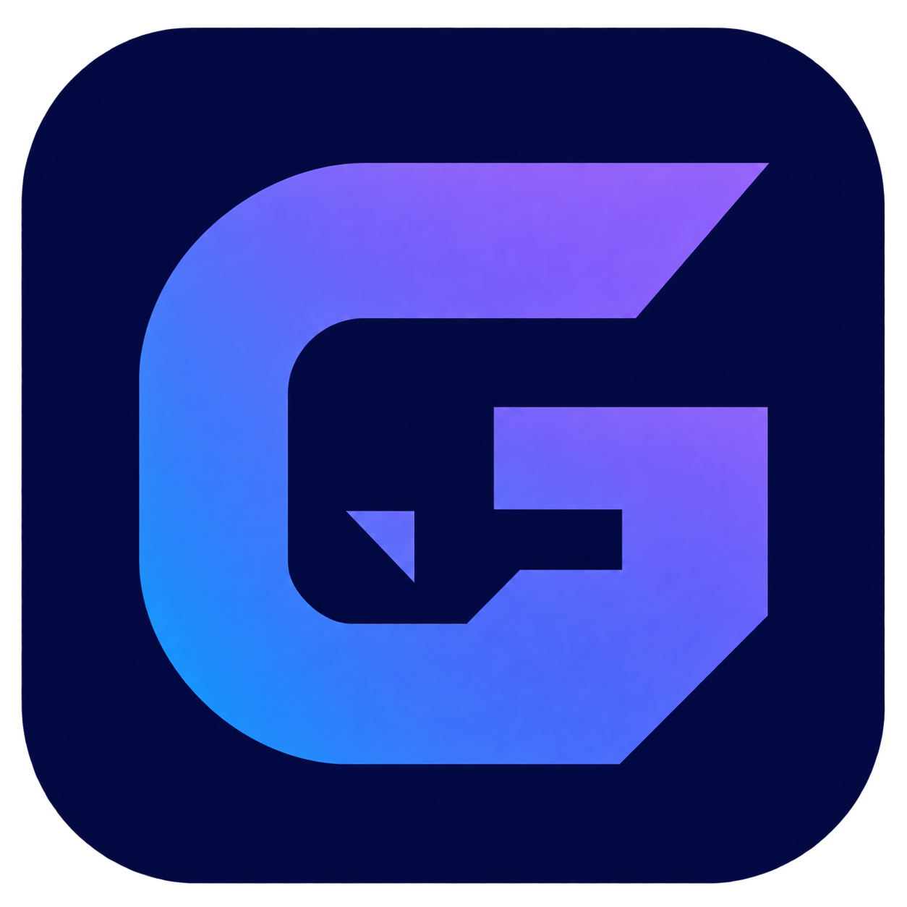
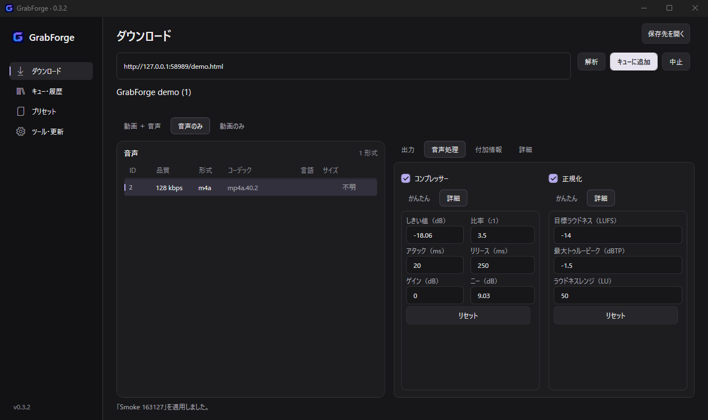

<p align="center">
  
</p>

<h1 align="center">GrabForge</h1>

<p align="center">yt-dlp と FFmpeg を、ひとつの Windows アプリに。</p>

<p align="center">
  <a href="https://github.com/itan2929/GrabForge/actions/workflows/build.yml"></a>
  <a href="https://github.com/itan2929/GrabForge/releases/latest"></a>
  <a href="LICENSE"></a>
  
</p>

<p align="center">
  <a href="https://github.com/itan2929/GrabForge/releases/latest"><strong>ダウンロード</strong></a> ·
  <a href="#はじめる">はじめる</a> ·
  <a href="#できること">機能</a> ·
  <a href="https://github.com/itan2929/GrabForge/issues">Issues</a>
</p>

<p align="center"></p>

ブラウザを開かずに、メディアの取得から音声の仕上げまで。C# / WPF によるネイティブ UI と、展開して使えるポータブル構成です。

## はじめる

1. [Releases](https://github.com/itan2929/GrabForge/releases/latest) から **`GrabForge-vX.Y.Z-win-x64.zip`** をダウンロードし、書き込み可能なフォルダへ**全体を展開**します。
2. **`GrabForge.exe`** を起動し、「ツール・更新」→「まとめて準備 / 更新」を実行します。
3. URL を入力して「解析」。映像・音声と出力設定を選び、キューに追加します。

Windows x64 向けです。.NET 実行環境は同梱済み。Python・Node.js・ブラウザのインストールは不要です。初回のツール取得にはインターネット接続が必要です。

## できること

| | |
|---|---|
| **メディア取得** | 映像・音声を個別に選択。動画＋音声／音声のみ／動画のみ、複数 URL、プレイリスト範囲指定 |
| **出力** | MP4・MKV・WebM、MP3・M4A・Opus・FLAC・WAV。周波数、CBR/VBR、ビットレートと保存名プレビュー |
| **音声処理** | コンプレッサーと2パスのラウドネス正規化。「かんたん／詳細」で調整し、処理前後の音量をログで確認 |
| **付加情報** | 字幕・自動字幕・チャプター・サムネイル・メタデータ、SponsorBlock |
| **キューとプリセット** | 同時実行、一時停止・再開・キャンセル・再試行、履歴。全設定の保存と JSON 入出力 |
| **ツール・更新** | yt-dlp・FFmpeg・ffprobe・Deno の取得と更新、SHA-256 照合、本体のリリース検知とポータブル更新 |

プロキシ、ブラウザ Cookie、速度制限、再試行、並列フラグメント、ダウンロードアーカイブ、追加の yt-dlp 引数も設定できます。

## ポータブル運用・アップデート

起動するファイルは **`GrabForge.exe`** です。内部ファイルは **`app/`** にまとめています。初回起動後の構成は次のとおりです。

```text
GrabForge.exe     起動用
app/              アプリ本体・ヘルプ・ライセンス
data/             設定・プリセット・履歴・ツール・更新バックアップ
downloads/        標準の保存先（変更可能）
```

ヘルプとライセンスは「ツール・更新」→「ヘルプ・ライセンス」から開けます。旧版の `tools/` も引き続き利用します。新規導入では外部ツールを `data/tools/` に保存し、PC の PATH や既存のツールは変更しません。フォルダごと移動すれば設定も持ち運べます。保存先を絶対パスで指定した場合は、移動先に合わせて変更してください。

ZIP直下の `release.json` は旧版の自動更新との互換性に必要な情報です。初回起動時に `app/` 内へ整理されます。旧版から更新した際に残るDLL・説明書・更新用フォルダーは、利用者のファイルを残したまま `data/backups/` へ退避します。

v0.2.1以降は「ツール・更新」で本体を更新できます。更新時は `data/` と既存の `tools/` を保持し、旧本体をバックアップします。

**v0.1.0 / v0.2.0 からは、アプリを終了してZIP全体を同じフォルダへ上書き展開してください。** 旧版の更新ヘルパーには停止する不具合があります。すでに更新操作が停止している場合は、タスクマネージャーで `GrabForge.Updater.exe` を終了してから展開します。ZIPには `data/`・`tools/` を含めないため、設定や導入済みツールを保持できます。

<details>
<summary>形式・音声処理・認証について</summary>

- 利用できる形式や認証条件はサイトに依存します。コーデックと保存コンテナの互換性も確認してください。
- 正規化は指定した LUFS にそろえる処理です。必ず音が大きくなるとは限りません。
- 音声変換と加工の併用では、メタデータ・チャプター処理の順序により2回エンコードする場合があります。元音源を残す場合は「元ファイルも保持」を使用してください。
- WAV・FLAC はビットレート設定の対象外です。字幕・画像・チャプターの対応範囲はコンテナに依存します。
- プリセットには接続設定も含まれます。共有前に内容を確認してください。
- 本体のコード署名はありません。コンテンツの利用権限を確認してください。DRM を回避する機能はありません。

</details>

## 開発

開発には Windows、**.NET 10 SDK**、PowerShell 7 を使用します。配布版の実行にはSDK・PowerShellの追加導入は不要です。

```powershell
dotnet run --project src/GrabForge.Desktop
./scripts/build.ps1          # build + unit tests
./scripts/build.ps1 -Publish # self-contained ZIP + SHA-256
```

実メディア・キューの検証:

```powershell
dotnet run --project tests/GrabForge.Integration -- install artifacts/qa
dotnet run --project tests/GrabForge.Integration -- verify artifacts/qa
```

```text
src/
  GrabForge.Core/      メディア・音声処理・キュー・永続化・更新
  GrabForge.Desktop/   WPF UI
  GrabForge.Updater/   本体終了後の更新適用・復元
tests/                単体テストと実変換の検証
assets/               ロゴ・マルチサイズ ICO
build/                配布用EXEの生成ツール
artifacts/packages/   配布ZIP・SHA-256
artifacts/publish/    配布内容の確認用
artifacts/qa/         実行テスト・一時データ（Git対象外）
.local/               ローカル運用用のアプリ・個人データ（Git対象外）
.tools/               開発用SDK（Git対象外）
```

不具合報告・改善案・PR を歓迎します。挙動を変更する場合は関連するテストを実行し、UI は実画面で確認してください。検証内容は [ACCEPTANCE.md](docs/ACCEPTANCE.md)、公開手順は [RELEASING.md](docs/RELEASING.md) を参照してください。

## ライセンス・謝辞

GrabForge は [MIT License](LICENSE) で公開しています。

UIの改善には、Damir Sokolovsky作 [unslop](https://github.com/heydamir/unslop)（[CC BY 4.0](https://creativecommons.org/licenses/by/4.0/)）の指針を使用しています。[デザイン方針](docs/DESIGN.md)も参照してください。

[yt-dlp](https://github.com/yt-dlp/yt-dlp)、[FFmpeg](https://ffmpeg.org/)、[BtbN builds](https://github.com/BtbN/FFmpeg-Builds)、[Deno](https://deno.com/) を利用しています。外部ツールは配布 ZIP に含めず、各配布元から取得します。それぞれのライセンスは [Third-party notices](THIRD-PARTY-NOTICES.md) を参照してください。
